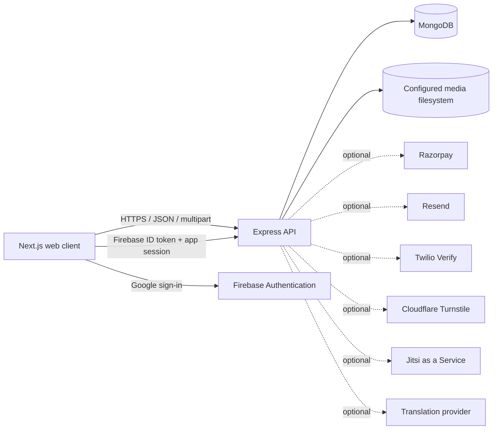

<div align="center">

# YourTube

### A video-sharing and learning platform

Discover, watch, save, and discuss video content—with creator tools, protected playback, membership billing, and private meetings.

[](https://nextjs.org/)
[](https://react.dev/)
[](https://www.typescriptlang.org/)
[](https://expressjs.com/)
[](https://www.mongodb.com/)
[](https://firebase.google.com/)

</div>

> **Project context:** YourTube extends the original internship training project. It keeps the established repository and technology stack while adding creator, security, media, community, and subscription capabilities.

---

## Contents

- [Overview](#overview)
- [Features](#features)
- [Architecture](#architecture)
- [Technology](#technology)
- [Run locally](#run-locally)
- [Configuration](#configuration)
- [Quality checks](#quality-checks)
- [Deployment and media storage](#deployment-and-media-storage)
- [Known constraints](#known-constraints)
- [Project structure](#project-structure)
- [Security notes](#security-notes)

## Overview

YourTube is a full-stack video platform with a Next.js frontend, an Express API, and MongoDB persistence. Firebase Authentication establishes user identity; the backend uses that identity to issue and validate application sessions for protected operations.

The application brings together a creator dashboard, video discovery and playback, watch history and saved lists, plan-based downloads, verified memberships, moderated conversations, account-security tools, and authenticated JaaS meeting rooms.

### At a glance

| | |
| --- | --- |
| **Application** | YourTube |
| **Frontend** | Next.js 15, React 19, TypeScript |
| **API** | Node.js, Express 5 |
| **Persistence** | MongoDB with Mongoose |
| **Identity** | Firebase Authentication + server-validated app sessions |
| **Media** | Local or configured server filesystem; MongoDB stores metadata |
| **Frontend hosting** | Vercel-compatible |
| **Backend hosting** | Node-compatible; Render configuration is included |

## Features

### Video discovery and creator tools

- Browse and search the video library, and open creator channels.
- Upload MP4 videos from the creator dashboard, see upload progress, and refresh the list after upload.
- View actual channel videos rather than sample/demo entries; switch between the Videos and About views.
- Optionally provide separately encoded 360p, 480p, 720p, and 1080p renditions during upload.
- Save videos to Watch later, like videos, review playback history, and play through saved lists in order.

### Playback and media access

- Custom HTML5 player with playback, seeking, volume, speed, fullscreen, theater mode, and Picture-in-Picture controls.
- Captions when available, buffering and playback indicators, timeline frame previews, and quality selection for uploaded renditions.
- Periodically saved playback position, resume support, and next-video behavior.
- Short-lived, session-bound media access rather than a public static uploads directory.
- Premium-video access checks and authenticated download authorization.

### Memberships, billing, and downloads

- Free, Bronze, Silver, and Gold plan comparison and subscription status.
- Razorpay order creation and server-side payment verification before membership activation.
- Billing history, transaction receipts, and receipt-delivery status.
- Subscription-aware download quotas, download history, duplicate checks, and transfer auditing.

> Razorpay is intended to be exercised with **Test Mode** credentials during development and evaluation. Never use a payment result supplied only by the browser to activate a plan.

### Community and moderation

- Comment threads with replies, reactions, sorting, and channel mentions.
- Time-limited editing, soft deletion, and persisted edit history.
- Comment reports with a moderator review queue and moderation actions.
- Rate limits and abuse controls, with optional Cloudflare Turnstile after repeated posting attempts.
- Optional translation-provider integration with cached language-specific results.

### Account security and meetings

- Firebase sign-in with additional email verification for new or untrusted login contexts.
- Signed application sessions, trusted-device management, and security activity history.
- Optional SMS verification through Twilio Verify.
- Private Jitsi as a Service (JaaS) rooms with short-lived, room-scoped tokens and host moderation privileges.
- Optional local GeoLite2 City lookup for approximate login-location information.

## Architecture



The browser authenticates with Firebase. For protected endpoints, it sends a Firebase ID token together with the YourTube application-session and device headers. The API validates those credentials, applies authorization and plan rules, and reads or writes MongoDB records. Video files are stored on the configured filesystem; MongoDB stores their metadata and references.

## Technology

| Layer | Technologies |
| --- | --- |
| Frontend | Next.js 15 Pages Router, React 19, TypeScript, Tailwind CSS 4 |
| UI | Radix UI primitives, Lucide icons, Sonner notifications |
| API | Node.js, Express 5, Multer |
| Database | MongoDB, Mongoose |
| Authentication | Firebase Authentication, signed application sessions |
| Payments | Razorpay |
| Email / SMS | Resend, optional Twilio Verify |
| Meeting provider | Jitsi as a Service |
| Optional abuse / language / location providers | Cloudflare Turnstile, translation API, MaxMind GeoLite2 |

## Run locally

### Prerequisites

- Windows, macOS, or Linux
- Node.js and npm
- MongoDB Community Server or an accessible MongoDB deployment
- A Firebase project for authenticated flows

### 1. Install dependencies

From the repository root:

```powershell
cd server
npm ci
cd ..\yourtube
npm ci
cd ..
```

### 2. Configure environment files

Create local files from the checked-in examples:

```powershell
Copy-Item server\.env.example server\.env
Copy-Item yourtube\.env.example yourtube\.env.local
```

At minimum, set the backend values below in `server/.env`:

```dotenv
PORT=5000
DB_URL=mongodb://127.0.0.1:27017/yourtube
FIREBASE_PROJECT_ID=your-firebase-project-id
APP_SESSION_SECRET=replace-with-a-random-secret-at-least-32-characters
MEDIA_TOKEN_SECRET=replace-with-a-different-random-secret-at-least-32-characters
UPLOAD_DIR=./uploads
```

Set the frontend API endpoint in `yourtube/.env.local`:

```dotenv
NEXT_PUBLIC_BACKEND_URL=http://localhost:5000
```

Configure the Firebase web app values in `yourtube/src/lib/firebase.js`. Use the same Firebase project ID in the backend configuration, enable the required sign-in provider, and authorize `localhost` in Firebase Authentication.

### 3. Start MongoDB, API, and frontend

Start MongoDB, then open two terminals at the repository root:

```powershell
# Terminal 1
cd server
npm run dev
```

```powershell
# Terminal 2
cd yourtube
npm run dev
```

Open **http://localhost:3000**. The API listens on **http://localhost:5000**. Confirm that MongoDB is available and check the API health endpoint:

```powershell
Invoke-RestMethod http://localhost:5000/health
```

The backend waits for its database connection before listening. If the health endpoint reports that the database is unavailable, check that MongoDB is running and that `DB_URL` is correct.

### Windows launcher

The repository also includes `start.bat` for local startup. It can start a local MongoDB process when it finds `mongod` in `PATH` or in a sibling `mongodb*` directory. When no backend `.env` exists, it uses a local MongoDB URL and temporary generated session/media secrets for that run. Local MongoDB data is stored under `%LOCALAPPDATA%\YourTube\MongoData`. Existing environment files are not overwritten.

### Run without optional providers

The frontend and backend can start without optional payment, SMS, CAPTCHA, translation, GeoIP, or JaaS credentials. Features that depend on an unconfigured provider will not be available. Authenticated flows also require working Firebase configuration and MongoDB connectivity.

## Configuration

Use `server/.env.example` and `yourtube/.env.example` as the source of truth for available environment variables. Provider secrets belong on the backend. Only variables explicitly prefixed `NEXT_PUBLIC_` should be exposed to the browser.

| Capability | Configuration | Notes |
| --- | --- | --- |
| MongoDB | `DB_URL` | Local MongoDB or a hosted connection string. |
| Identity and sessions | `FIREBASE_PROJECT_ID`, `APP_SESSION_SECRET` | Use the matching Firebase project; keep the session secret private. |
| Protected media | `MEDIA_TOKEN_SECRET`, `UPLOAD_DIR` | Use a distinct secret; point `UPLOAD_DIR` at durable storage for production uploads. |
| Razorpay | `RAZORPAY_KEY_ID`, `RAZORPAY_KEY_SECRET` | Use test credentials for evaluation; keep the secret on the backend. |
| Security and receipt email | `RESEND_API_KEY`, `SECURITY_EMAIL_FROM`, optional `SUPPORT_EMAIL` | Sender identity must be accepted by the provider; production usually requires a verified domain. |
| SMS verification | `TWILIO_ACCOUNT_SID`, `TWILIO_AUTH_TOKEN`, `TWILIO_VERIFY_SERVICE_SID` | Optional Twilio Verify integration. |
| Comment CAPTCHA | Backend `TURNSTILE_SECRET_KEY`; frontend `NEXT_PUBLIC_TURNSTILE_SITE_KEY` | Configure keys for the deployed frontend domain. |
| Translation | `TRANSLATION_API_URL`, optional `TRANSLATION_API_KEY` | The provider must implement the API contract expected by the backend. |
| JaaS meetings | `JITSI_APP_ID`, `JITSI_API_KEY_ID`, `JITSI_PRIVATE_KEY` | Store the private key only in backend secrets; encode newlines as `\n` when required by the host. |
| Moderator access | `MODERATOR_EMAILS` | Comma-separated moderator account emails. |
| Optional local GeoIP | `GEOIP_DB_PATH` | Path to a separately obtained GeoLite2 City `.mmdb`; do not commit the database file. |
| Frontend API | `NEXT_PUBLIC_BACKEND_URL` | Public HTTPS URL of the backend in a deployed frontend build. |

## Quality checks

Run backend tests:

```powershell
cd server
npm test
```

Type-check the frontend:

```powershell
cd yourtube
npx tsc --noEmit
```

Build the production frontend:

```powershell
npm run build
```

For local production-mode startup, run `npm start` from `server/` and `yourtube/` after building the frontend.

## Deployment and media storage

The frontend and backend are separate deployable services from this repository:

1. **Frontend:** deploy `yourtube/` to Vercel. Set `NEXT_PUBLIC_BACKEND_URL` to the backend's public HTTPS URL. This setting is embedded at build time, so rebuild/redeploy after changing it.
2. **Backend:** deploy `server/` as a Node service with `npm ci` and `npm start`. Configure its environment variables in the host's secret manager.
3. **Database:** configure a hosted MongoDB connection and permit network access from the backend host.
4. **Identity:** add the deployed frontend hostname to the Firebase Authentication authorized domains and verify sign-in from the public domain.
5. **Media:** configure durable storage for uploaded source videos and optional quality renditions.

The included [`server/render.yaml`](server/render.yaml) describes a Render backend with a **1 GB persistent disk** mounted at `/var/data/yourtube`. This disk is a paid configuration, not part of Render Free. Render Free filesystems are ephemeral: media uploaded there may disappear after sleep, restart, or redeployment. MongoDB stores metadata, not the raw video files. A production deployment needs persistent disk or an object-storage service wired into the upload and playback paths.

> **Deployment status:** The project owner reports that the frontend and backend are already deployed and synced. Add and verify the public demo URL here before final submission; this README does not guess or invent a URL.

## Known constraints

- Live provider features require valid credentials and provider-side setup; code support alone does not prove a live provider flow.
- A real JaaS multi-participant test needs at least two signed-in participants.
- Translation requires a compatible translation provider endpoint and, if required, its API key.
- Twilio SMS, Turnstile CAPTCHA, and GeoLite2 lookup are optional integrations.
- GeoLite2 lookup requires a separately obtained `.mmdb` file. Never commit it.
- Upload support validates MP4 files and limits each uploaded file to 100 MiB. Check proxy/host request-size limits as well.
- Uploaded quality variants must be provided as separate encoded MP4 files; the application does not transcode videos.
- Authorized playback and download controls enforce application access and quotas, but cannot prevent screen capture or copying by a user who can view the media.
- Automatic recurring billing, DRM, and call recording are not provided.

## Project structure

```text
.
├── server/
│   ├── controllers/      # API and business logic
│   ├── middleware/       # Authentication and request controls
│   ├── Modals/           # Mongoose models
│   ├── routes/           # Express route registration
│   ├── utils/            # Shared backend helpers
│   ├── uploads/          # Local development media (do not commit uploads)
│   ├── index.js          # API entry point
│   └── render.yaml       # Optional Render persistent-disk blueprint
├── yourtube/
│   ├── src/
│   │   ├── components/   # Shared interface components
│   │   ├── lib/          # Firebase, API, and client helpers
│   │   ├── pages/        # Next.js Pages Router routes
│   │   └── styles/       # Global styles
│   └── package.json
├── start.bat             # Optional Windows development launcher
└── README.md
```

## Security notes

- Never commit `.env` files, private keys, payment secrets, database credentials, user uploads, or GeoLite2 databases.
- Keep Firebase ID-token validation, application-session validation, payment verification, premium entitlements, and download authorization on the server.
- Use separate, randomly generated values for `APP_SESSION_SECRET` and `MEDIA_TOKEN_SECRET`.
- Use HTTPS and restrictive CORS settings for public deployments.
- Use Razorpay Test Mode for testing; do not publish payment secrets or production credentials.
- Review hosting provider storage, request-size, sleep, and bandwidth limits before accepting real uploads.

---

<div align="center">

**Built as an extension of the original YourTube internship training project.**

</div>
